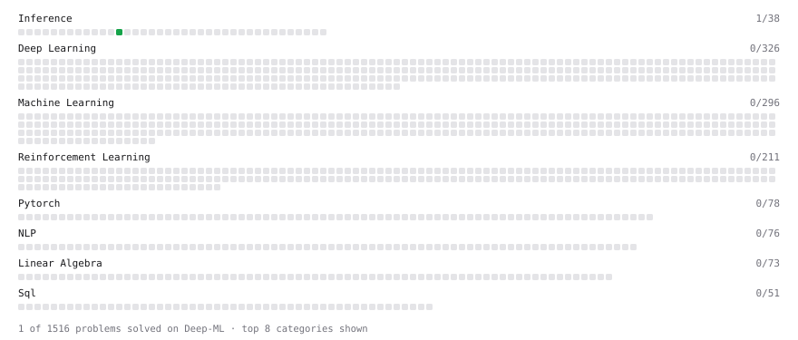

# Deep-ML

My machine learning practice from [Deep-ML](https://www.deep-ml.com). Every solution here was written by hand.

**14** solved · 1 problems · 0 labs · 13 math

[**Browse the interactive portfolio**](https://Player256.github.io/deep-ml/) to replay this filling in over time.

## Problems

| | Difficulty | Solved | |
| --- | --- | --- | --- |
| [Per-Token Decode Latency from Memory Bandwidth](https://www.deep-ml.com/problems/1214) | easy | 2026-10-11 | [solution](problems/1214-per-token-decode-latency-from-memory-bandwidth) |

## Math

| | Difficulty | Solved | |
| --- | --- | --- | --- |
| [Attention as a Soft Dictionary Lookup](https://www.deep-ml.com/math-problems/133) | easy | 2026-10-31 | [solution](math/0133-attention-as-a-soft-dictionary-lookup) |
| [Derivatives and Gradients](https://www.deep-ml.com/math-problems/1) | easy | 2026-10-31 | [solution](math/0001-derivatives-and-gradients) |
| [Gradient Descent Updates](https://www.deep-ml.com/math-problems/5) | easy | 2026-10-31 | [solution](math/0005-gradient-descent-updates) |
| [Why Minibatches: Gradient Variance vs Batch Size](https://www.deep-ml.com/math-problems/130) | easy | 2026-10-31 | [solution](math/0130-why-minibatches-gradient-variance-vs-batch-size) |
| [Adam Bias Correction](https://www.deep-ml.com/math-problems/132) | medium | 2026-10-31 | [solution](math/0132-adam-bias-correction) |
| [Backpropagation and the Chain Rule](https://www.deep-ml.com/math-problems/4) | medium | 2026-10-31 | [solution](math/0004-backpropagation-and-the-chain-rule) |
| [Convolution Arithmetic and Parameter Sharing](https://www.deep-ml.com/math-problems/116) | medium | 2026-10-31 | [solution](math/0116-convolution-arithmetic-and-parameter-sharing) |
| [Multivariate Calculus](https://www.deep-ml.com/math-problems/2) | medium | 2026-10-31 | [solution](math/0002-multivariate-calculus) |
| [Neural Network Derivatives](https://www.deep-ml.com/math-problems/3) | medium | 2026-10-31 | [solution](math/0003-neural-network-derivatives) |
| [Optimization: Convexity and Critical Points](https://www.deep-ml.com/math-problems/6) | medium | 2026-10-31 | [solution](math/0006-optimization-convexity-and-critical-points) |
| [Scaled Dot-Product Variance: Why Divide by the Square Root of d](https://www.deep-ml.com/math-problems/134) | medium | 2026-10-31 | [solution](math/0134-scaled-dot-product-variance-why-divide-by-the-square-root-of-d) |
| [Variance Preservation and He/Glorot Scaling](https://www.deep-ml.com/math-problems/131) | medium | 2026-10-31 | [solution](math/0131-variance-preservation-and-he-glorot-scaling) |
| [Recurrent Networks, Weight Sharing and Vanishing Gradients](https://www.deep-ml.com/math-problems/117) | hard | 2026-10-31 | [solution](math/0117-recurrent-networks-weight-sharing-and-vanishing-gradients) |

---

_This file is regenerated by Deep-ML on every push._
